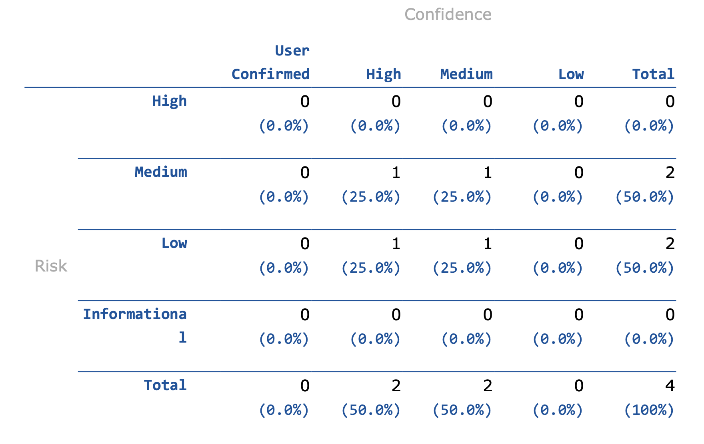
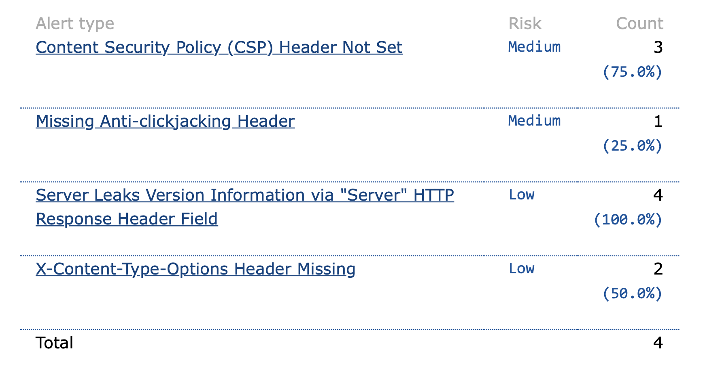
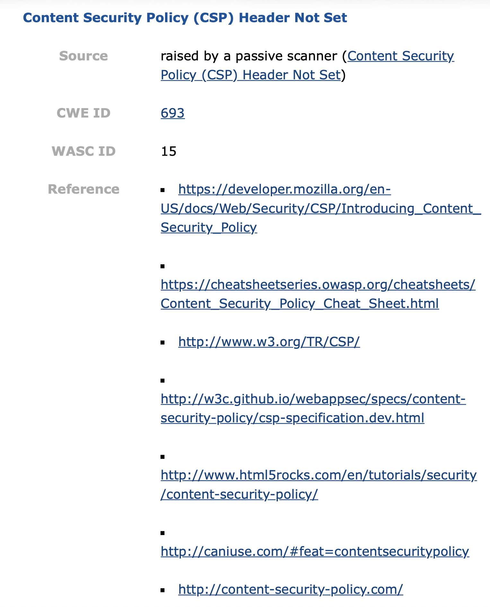
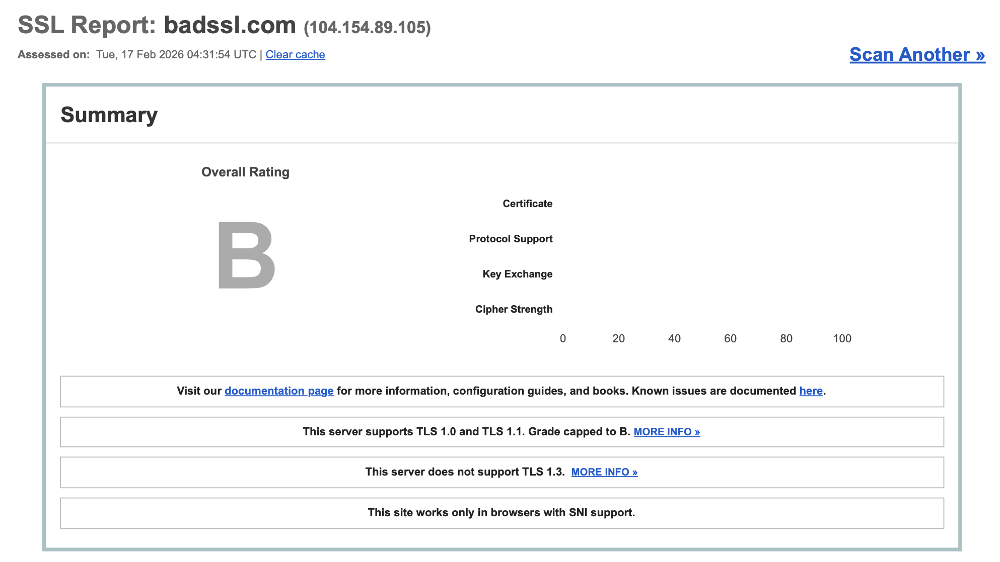
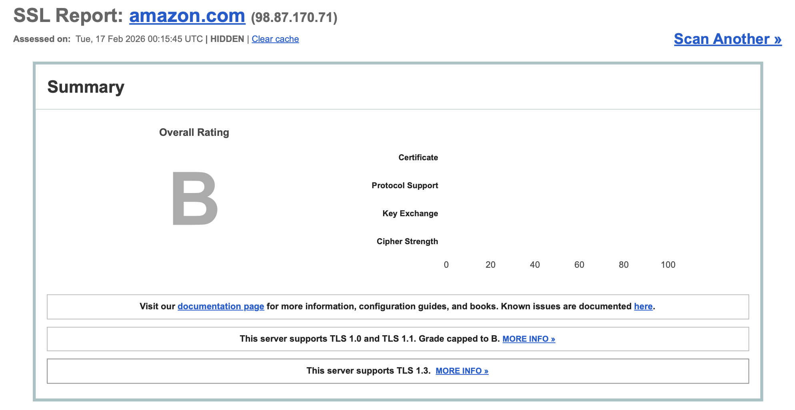

# Web Application Security Assessment

## Project Overview

This project focused on assessing web application and TLS security using OWASP ZAP and Qualys SSL Labs.

I used OWASP ZAP to scan a web application for common security weaknesses and reviewed the resulting alerts by risk level and confidence. I also used Qualys SSL Labs to evaluate TLS configuration on public websites and compare how protocol support affected the overall security grade.

The project demonstrates a basic web application security assessment workflow of scanning, reviewing findings, interpreting risk, and identifying recommended security improvements.

## Objectives

- Perform a web application security scan using OWASP ZAP.
- Review findings by severity and confidence level.
- Identify missing HTTP security headers.
- Interpret common web-security weaknesses.
- Evaluate TLS protocol support using Qualys SSL Labs.
- Compare TLS configurations across different public websites.
- Document recommended security improvements.

## Tools & Technologies

- OWASP ZAP
- Qualys SSL Labs
- HTTP security headers
- TLS / SSL analysis
- CWE classification
- Web application security
- Passive vulnerability scanning

## OWASP ZAP Assessment

The ZAP scan produced 4 total alerts:

- 0 High
- 2 Medium
- 2 Low

*OWASP ZAP alert summary showing the distribution of Medium and Low findings.*

## Identified Web Security Findings

The scan identified several HTTP security weaknesses:

- Content Security Policy (CSP) Header Not Set — Medium
- Missing Anti-clickjacking Header — Medium
- Server Leaks Version Information via the `Server` HTTP Response Header — Low
- X-Content-Type-Options Header Missing — Low

*Summary of the alert types identified by the OWASP ZAP scan.*

## Content Security Policy Finding

One of the Medium findings was a missing Content Security Policy header.

Content Security Policy can help reduce the impact of certain client-side attacks by controlling which resources a browser is allowed to load and execute.

The ZAP report associated this finding with:

- CWE ID 693
- WASC ID 15

*OWASP ZAP finding showing that a Content Security Policy header was not configured.*

## Recommended Web Security Improvements

Based on the scan results, recommended improvements included:

- Implement a Content Security Policy header.
- Configure anti-clickjacking protection.
- Reduce unnecessary server-version disclosure.
- Add the `X-Content-Type-Options` header.
- Review HTTP response headers as part of routine application-security testing.

These findings demonstrate how security headers can provide additional layers of protection even when no High-severity vulnerability is identified.

## TLS Assessment with Qualys SSL Labs

In addition to the web application scan, I reviewed TLS configuration using Qualys SSL Labs.

### badssl.com

The assessed badssl.com endpoint received an overall grade of **B**.

The report showed that the server:

- Supported TLS 1.0
- Supported TLS 1.1
- Did not support TLS 1.3

The SSL Labs report stated that support for TLS 1.0 and TLS 1.1 caused the grade to be capped at B.

*Qualys SSL Labs result for badssl.com showing a B rating and support for older TLS versions.*

### amazon.com

The assessed Amazon endpoint also received an overall grade of **B**.

The server supported:

- TLS 1.0
- TLS 1.1
- TLS 1.3

Although TLS 1.3 was supported, the continued support for TLS 1.0 and TLS 1.1 caused the overall grade to remain capped at B.

*Qualys SSL Labs result for an Amazon endpoint showing a B rating, legacy TLS support, and TLS 1.3 support.*

## Key Findings

The web application scan identified configuration weaknesses rather than High-severity application vulnerabilities.

The most significant findings were related to missing HTTP security headers, including CSP and anti-clickjacking protections.

The TLS assessments also demonstrated that supporting modern TLS does not automatically result in the strongest security rating if older protocols remain enabled.

## Lessons Learned

- Automated web application scanners can quickly identify missing security controls and configuration weaknesses.
- Medium and Low findings should still be reviewed because they can contribute to a larger attack surface.
- HTTP security headers provide important defense-in-depth protections.
- TLS configuration should be evaluated beyond certificate validity alone.
- Supporting legacy protocols can reduce the overall security posture even when newer protocols are available.
- Security assessments should combine multiple tools because different tools evaluate different layers of an application environment.

## Skills Demonstrated

- OWASP ZAP scanning
- Web application vulnerability assessment
- HTTP security header analysis
- TLS / SSL configuration analysis
- CWE interpretation
- Risk classification
- Security finding documentation
- Web security recommendations
- Qualys SSL Labs analysis

## Lab Disclaimer

The OWASP ZAP portion of this project was completed in an authorized educational cybersecurity lab environment.

The Qualys SSL Labs portion involved passive review of publicly available TLS configuration information. No unauthorized exploitation or intrusive testing was performed against external systems.